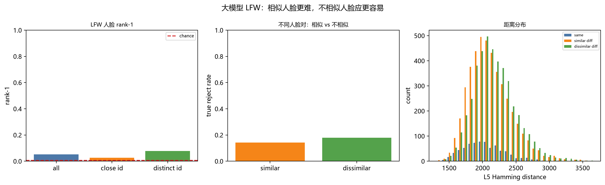

# 大模型 LFW 直接测试：相似的人脸 vs 不相似的人脸

## 1. 设置

- 155 个身份 / 1,805 张 196×108 彩色中心人脸；
- 每个身份 60% discovery，40% validation；
- 大模型：196×108×60 → … → 196×108×240，L5 约 5.08M 神经元，不训练；
- 取 L5 的 30,000 个随机神经元，不选固定身份组合；
- 每个身份用 discovery 的平均激活作原型；
- rank-1：validation 人脸离哪个身份原型最近。

另外按“人脸是否相似”分组：

- 用 discovery 的平均人脸像素距离，找每个身份最相似的另一个身份；
- `close id`：最近他人距离低于中位数（容易混）；
- `distinct id`：最近他人距离高于中位数（不容易混）。

## 2. 结果

| 指标 | 数值 |
|---|---:|
| Rank-1 全部 | **5.16%** |
| 随机基线（155 类） | 0.65% |
| Rank-1：相似身份（close） | **2.67%** |
| Rank-1：不相似身份（distinct） | **7.76%** |
| 同身份距离均值 | 2,042 |
| 相似不同人距离均值 | 2,107 |
| 不相似不同人距离均值 | 2,172 |
| 90% 同身份接受阈值 | 2,441 |
| 相似不同人 true reject | **14.2%** |
| 不相似不同人 true reject | **17.9%** |



## 3. 说明什么

1. **方向符合直觉**
   - 不相似身份 rank-1 7.76%，相似身份 2.67%；
   - 不相似人脸的 true reject 也略高（17.9% vs 14.2%）；
   - 人脸越不相似，越容易被分开；越相似，越容易混。

2. **但绝对水平还远远不够**
   - 全部 rank-1 只有 5.16%；
   - 不相似身份也只有 7.76%，远低于可用识别；
   - true reject 只有 14–18%，大部分不同人仍被当作同一个人。

3. **说明当前大模型不是人脸识别器**
   - 它能保留画面相似性；
   - 但静态单帧 + 固定原型，不能稳定按身份聚类；
   - 这和之前固定身份神经元/组合的负结果一致。

4. **和“连续观察”不矛盾**
   - 这里每张脸是独立单帧；
   - 同一个人不同姿势/光线本来就会激活不同模式；
   - 要维持身份，需要时间状态轨迹，不是单帧固定原型。

## 4. 结论

> **人脸越不相似，模型确实越容易区分；但当前静态大模型仍远不能可靠识别人脸。**
> 相似人脸更难，不相似人脸也只是“相对更容易”，不是“已经能认”。

## 5. 限制

- LFW 是静态图片，没有连续视频；
- 只有 155 个身份；
- 没有 foveated 输入；
- 没有多 seed/置信区间；
- 没有训练/度量学习；
- 不能把这个结果当作人脸识别产品。

## 6. 文件

```
threednet/lfw_face_recognition.py
results/lfw_face_recognition.json
results/fig_lfw_face_recognition.png
LFW_FACE_RECOGNITION.md
```
