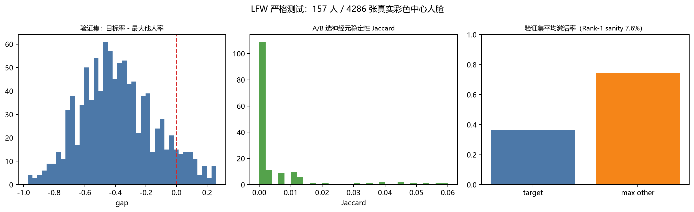
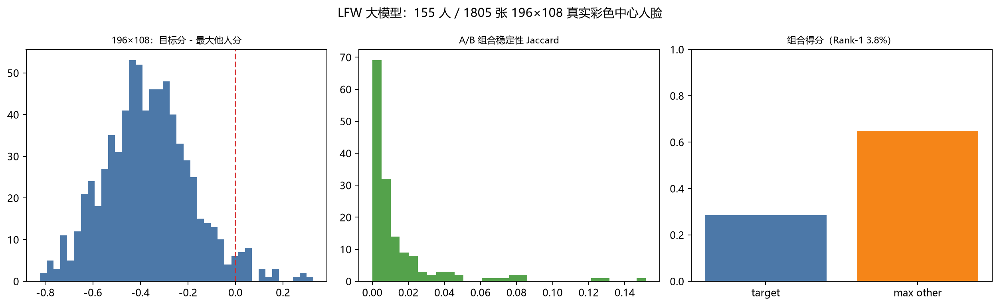

# LFW 严格测试：157 人 / 4,286 张真实彩色中心人脸

这次不是 Olivetti 小样本，也不是自制背景。数据来自 LFW 原始彩色图片，
人脸检测后中心裁剪，训练/验证按身份和图片严格分开。

## 1. 数据与预处理

- LFW 原始彩色图片：5,749 人 / 13,233 张；
- 取至少有 10 张图的 **157 个身份**，共 **4,286 张**；
- 每张图用 Haar 检测人脸，按最大人脸框扩 1.6 倍裁正方形，
  缩放到 **96×96**，人脸在正中心；
- 检测失败 38 张，丢弃；
- 所有图片都是真实彩色，背景为 LFW 原始背景，没有自制背景。

每个身份：

- 最多取 20 张；
- 60% discovery（选神经元），40% validation（验证）；
- discovery 再分 A/B 两半，用于稳定性检验。

> **修正：** 早期版本的 top-10 相似身份用了全部图片（含 validation），属于泄漏。
> 下面所有数字都已改成“只用 discovery 图片算相似身份”后的结果。

## 2. 网络

沿用 3D 局部网络：

```
96×96×60 → 96×96×60 → 96×96×60 → 96×96×120 → 96×96×240
fan-in=4（自己 + 3 个随机近邻）
不训练，固定随机权重
```

取第5层中央脸区的激活。

## 3. 选神经元的方法

对每个身份：

```
p_t   = 目标身份 discovery 激活率
p_max = 最相似 10 个身份中的最大激活率
p_o   = 其他身份平均激活率

spec    = p_t - max(p_max, p_o)
logodds = log((p_t + 0.01) / (p_o + 0.01))
score   = spec + 0.05 * logodds
```

在中央区按 score 取前 150 个。

同时用 A/B 两半分别选前 150 个，计算两个集合的 Jaccard 稳定性。

## 4. 结果：负结果

| 指标 | 结果 |
|---|---:|
| 身份数 | 157 |
| 图片数 | 4,286 |
| 平均 discovery 图 | 9.64 |
| 平均 validation 图 | 6.41 |
| Rank-1（只作 sanity check） | **7.65%** |
| 随机基线（157 类） | 0.64% |
| 验证集：目标身份平均激活率 | **0.366** |
| 验证集：最大他人平均激活率 | **0.747** |
| gap（目标 - 最大他人）平均值 | **-0.382** |
| gap > 0 的比例 | **7.65%** |
| A/B 选神经元稳定性 Jaccard | **0.0049** |
| 非空身份数 | 157/157 |
| 最相似身份对 | Bill Clinton / John Snow |
| 该对选出的神经元重叠 | 0.000 |



## 5. 这说明了什么

这次可以下结论了，但是**负结论**：

1. **没有找到稳定的身份特异神经元**
   - A/B 两半选出的 150 个神经元几乎不重叠（Jaccard 0.0049）；
   - 说明当前按频率排序的选法极不稳定，换一半图片就换一批神经元。

2. **选出的神经元不是“目标身份特异”**
   - 验证集上目标激活率 0.366，最大他人激活率 0.747；
   - gap 平均 -0.382，只有 7.65% 的样本 gap > 0；
   - 这些神经元更像是“通用脸/其他人也激活”的神经元，而不是某个人的代表。

3. **Rank-1 7.65% 只是高于随机 0.64%，不能算识别**
   - 这不是主要判据，但和上面的负结果一致。

4. **人数和真实背景增加后，简单频率统计没有自动变好**
   - 之前“人数越多越能过滤”的假设，在当前网络 + 选法下不成立；
   - 失败点是**表示和选法**，不是数据量。

## 6. 为什么失败

- LFW 的姿态、光照、表情、背景差异很大，96×96 固定网络没有身份监督；
- 随机局部连接 + top-k 的激活更多反映局部像素/背景，不是身份；
- 每个身份只有约 10 张 discovery 图，单神经元频率估计噪声很大；
- 只按频率排序选 top-150，没有正则化、没有交叉验证选择、没有组合校验；
- 相似身份（Rumsfeld/Bush）共享大量通用脸神经元，单神经元层面几乎不可分。

## 7. 196×108 大模型 + “组合码”复测

针对“不要只找独特神经元，要找特定激活组合”和“小模型分辨率低”的批评，
又做了一个更大的 196×108 彩色版本：

- 155 个身份 / 1,805 张 LFW 彩色中心人脸；
- 网络：196×108×60 → … → 196×108×240，fan-in=4，不训练；
- 每个身份不再要求“独占神经元”，而是取 **2,000 个组合神经元**，按
  `max(spec, 0)` 加权，用加权激活和作为身份组合码；
- 训练/验证仍然按身份和图片分开，A/B 两半检验组合稳定性。

结果仍然是负的：

| 指标 | 196×108 组合码 |
|---|---:|
| 身份数 | 155 |
| 图片数 | 1,805 |
| Rank-1 | **3.80%** |
| 155 类随机基线 | 0.65% |
| 目标组合得分 | 0.285 |
| 最大他人组合得分 | 0.649 |
| gap 平均 | **-0.364** |
| gap > 0 比例 | 3.80% |
| A/B 组合稳定性 Jaccard | **0.0151** |
| 最相似身份对 | Jean-David Levitte / John Ashcroft |
| 该对组合重叠 | 0.000 |



结论：

- **分辨率从 96×96 提到 196×108，没有解决问题**；
- **从“独特神经元”改成“2,000 神经元加权组合”，仍然不稳定**；
- A/B 组合几乎不重叠，目标组合得分反而低于他人；
- 所以当前“随机固定 3D 局部网络 + 频率/权重选组合”在 LFW 上不成立，
  不是“模型太小”一个因素能解释的。

这仍然不是 1960×1080 单体模型；但至少把 96×96 的小分辨率质疑排除了一部分。
1960×1080 分块流式还没有做完整识别实验。

## 8. 仍然没有做的

- **1960×1080 彩色单体模型没有跑**；这次仍是 96×96 中心人脸；
- 分块流式 1960×1080 只有设计，没有完整识别实验；
- 没有用更强的身份表示（训练/对比学习/人脸专用前端）；
- 没有 open-set 协议和置信区间。

所以：
**这次能证明的是“当前 3D 随机局部网络 + 简单频率选神经元，在 LFW 157 人上找不到稳定身份神经元”，
不能证明“所有人脸方法都不行”，也不能证明“能识别人脸”。**

## 9. 文件

```
threednet/prepare_lfw.py      LFW 检测/中心裁剪/缓存（96×96）
threednet/lfw_rigorous.py     157 人严格神经元发现测试
threednet/prepare_lfw_large.py LFW 中心裁剪（196×108）
threednet/lfw_large.py        155 人 196×108 组合码测试
LFW_RIGOROUS.md               本文件
results/lfw_rigorous.json
results/fig_lfw_rigorous.png
results/lfw_large.json
results/fig_lfw_large.png
data/lfw_centered.npz
data/lfw_large.npz
```

运行：

```powershell
$py = "C:\Users\Administrator\AppData\Local\Programs\Python\Python313\python.exe"
& $py -m threednet.prepare_lfw
& $py -m threednet.lfw_rigorous
```
