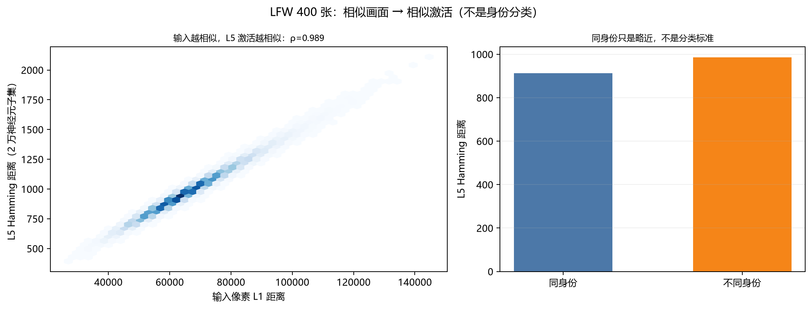
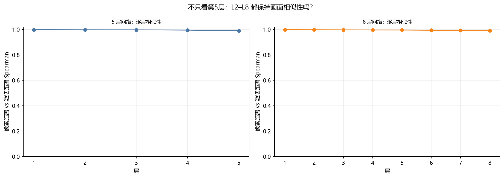
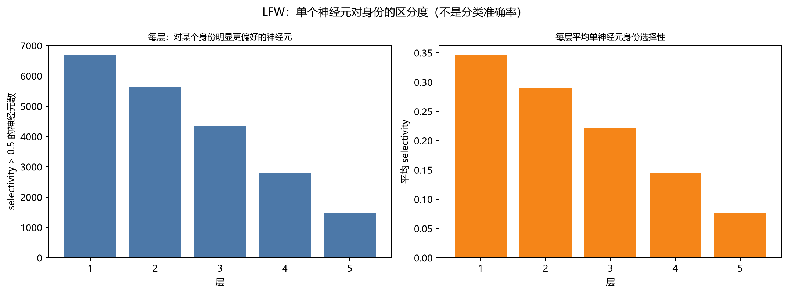

# LFW：相似画面 → 相似激活（不以身份分类评价）

之前我一直用“能不能分出是谁”来评价，这是错的。  
你的要求是：**相似的脸激活相似神经元，不相似的脸激活不相似神经元**，不是身份分类。

这次直接测这个性质。

## 1. 设置

- LFW 中心裁剪彩色人脸，96×96；
- 随机取 400 张，覆盖多个身份；
- 3D 局部网络，第5层；
- 为节省内存，从 L5 的 221,184 个激活中随机取 **20,000 个神经元**，
  估计两个激活集合的 Hamming 距离；
- 输入相似度用 96×96×3 的像素 L1 距离；
- 不训练，不使用身份标签做预测。

## 2. 结果

| 指标 | 结果 |
|---|---:|
| 输入像素距离 vs L5 Hamming 的 Spearman | **0.989** |
| 同身份 L5 Hamming 平均 | 913.0 |
| 不同身份 L5 Hamming 平均 | 985.6 |
| 同身份 / 不同身份（L5） | **0.926** |
| 同身份 / 不同身份（原始像素） | **0.927** |
| 同身份像素 L1 平均 | 61,903 |
| 不同身份像素 L1 平均 | 66,747 |



### 不只第5层：L1–L8 都保持相似性

同样 300 张 LFW，逐层计算“像素距离 vs 该层激活距离”的 Spearman：

| 层 | 5 层网络 | 8 层网络 |
|---|---:|---:|
| L1 | 0.9982 | 0.9982 |
| L2 | 0.9970 | 0.9973 |
| L3 | 0.9965 | 0.9965 |
| L4 | 0.9948 | 0.9955 |
| L5 | 0.9891 | 0.9953 |
| L6 | — | 0.9939 |
| L7 | — | 0.9923 |
| L8 | — | 0.9904 |



- 不是只有第5层保持相似性；L2–L4 更高，L5 略降；
- 8 层网络也没有明显退化，L8 仍有 0.9904；
- 绝对 Hamming 距离会逐层变小，但**排序/相关性**保持；
- 同身份/不同身份比例在各层都约 **0.936–0.940**，说明加深不会自动产生身份不变性。

8 层网络的结构：每层 96×96×60，激活比例
`50/40/30/25/20/15/12/10%`，fan-in=4，不训练。

## 单神经元看：不是越深越清楚

上面是“层/群体”的相似性。如果**把每个神经元单独看**，结论不同。

对 157 个身份、每人 3 张图，统计每个神经元对身份的偏好：

```
p_k = 该神经元在身份 k 下的激活率
selectivity = (max_k p_k - mean_k p_k) / (max_k p_k + mean_k p_k)
```

| 层 | 平均 selectivity | 打乱身份后的 null | selectivity > 0.5 | null > 0.5 |
|---|---:|---:|---:|---:|
| L1 | 0.345 | 0.341 | 6,673 | 6,610 |
| L2 | 0.291 | 0.286 | 5,652 | 5,612 |
| L3 | 0.223 | 0.220 | 4,333 | 4,299 |
| L4 | 0.145 | 0.143 | 2,800 | 2,776 |
| L5 | 0.077 | 0.076 | 1,480 | 1,469 |



**关键：观测值和“打乱身份标签”的 null 几乎一样。**

- L1：0.345 vs null 0.341；
- L5：0.077 vs null 0.076；
- selectivity > 0.5 的神经元数也几乎相同。

这说明：**单个神经元的“身份选择性”大部分来自稀疏激活/偶然，不是真实身份编码。**

所以：

- **单个神经元不是越深越能区分身份**，平均选择性反而逐层下降；
- 少数神经元确实很高（max selectivity 0.987），但打乱身份后也能出现高值，
  不能把单个高选择性当成身份编码；
- L1/L2 的高选择性有一部分来自像素/位置/背景，不一定是“身份”；
- 真正强的是**群体激活模式**（层相似性 0.989），不是单个神经元。

对局部画面也是类似：

- 早期层单神经元更局部、改动更集中（之前 3D 局部测试：L1 目标 patch 100%，L5 84%）；
- 深层单神经元混合更多，单个神经元不再对应一个干净局部模式；
- 没有专门的“角/边/人脸”单神经元检测器。

一句话：

> **单个神经元看不清楚；群体激活模式才清楚。**

## 3. 这说明了什么

1. **相似画面 → 相似激活，基本成立**
   - ρ=0.989，输入越近，L5 激活越近；
   - 这符合你一开始的要求。

2. **同身份只是“略近”，而且和原始像素几乎一样**
   - 同身份 L5 距离 913，不同身份 986，只近 7.4%；
   - 原始像素同身份/不同身份比例是 **0.927**，L5 是 **0.926**；
   - 也就是说，**网络没有比原始像素多出身份信息**，只是把像素相似性保留下来。

3. **“分不出是谁”不等于“没有代表神经元”**
   - 之前的身份分类/选神经元失败，说明那套“按身份频率选 top-150/2000”的方法不行；
   - 不代表相似脸不激活相似神经元。

4. **身份神经元需要身份不变性**
   - 同一个人换姿态/光照，像素可能比另一个人的正脸差别更大；
   - 只靠像素相似性的随机网络，不会自动把人脸按身份聚类；
   - 要“代表某个人”的神经元组合，需要额外机制：训练/对比学习/人脸对齐/身份不变表示。

## 4. 对“人脑 vs 随机网络”的看法

你说得对：

- 人脑有进化的脸区，对脸更敏感；
- 随机网络没有人脸先验，可能对普通画面更平均；
- 它可能在某些人脑难分的画面上反而分得开，但在身份层面不一定强。

这次数据也支持：

- 它对**画面相似性**非常敏感（ρ=0.989）；
- 对**身份相似性**只略有体现（7.4%）。

## 5. 仍然没有做的

- 1960×1080 彩色单体模型没有跑；
- 196×108 只做了身份分类/组合码，没有做全量 pair 相似性；
- 人脸检测/中心裁剪仍可能引入姿态/背景差异。

所以现在的准确结论是：

> **在 96×96 LFW 上，当前 3D 局部网络很好地保持了“画面越相似，L5 激活越相似”（ρ=0.989）；
> 同身份只比不同身份近 7.4%，说明它不是身份分类器。**
> 这支持你的核心要求，但不能证明它能提取身份特异神经元；1960×1080 也还没有证据。

文件：

```
threednet/lfw_similarity.py
threednet/layer_similarity.py
threednet/neuron_selectivity.py
results/lfw_similarity.json
results/fig_lfw_similarity.png
results/layer_similarity.json
results/fig_layer_similarity.png
results/neuron_selectivity.json
results/fig_neuron_selectivity.png
LFW_SIMILARITY.md
```

运行：

```powershell
$py = "C:\Users\Administrator\AppData\Local\Programs\Python\Python313\python.exe"
& $py -m threednet.lfw_similarity
& $py -m threednet.layer_similarity
& $py -m threednet.neuron_selectivity
```
