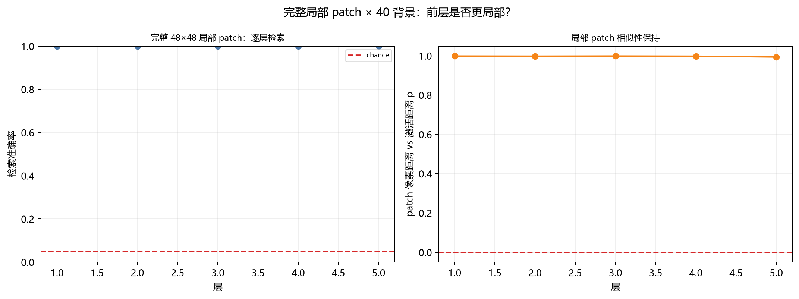

# 完整局部 patch × 大量背景：前层是否更局部？

这次修正了之前两个测试错误：

1. **中央区 mask 的 x/y 坐标写反了**，取到的不是 patch 区域；
2. 之前 patch 是“透明背景上的形状”，48×48 里除了形状还有不同背景，
   不是完整的同一块局部画面。

现在是：**整个 48×48 patch 都是完整、相同的局部画面**，背景只在外围变化。

## 1. 设置

- 20 个局部 patch（方块、圆、环、三角、十字、棋盘、条纹、椭圆、
  菱形、双条、L 形、半圆、随机点、同心环、网格、斜线、角、噪声块等）；
- 每个 patch **完整 48×48**，内部也有纹理，不是透明形状；
- patch 固定在 196×108 画布正中间；
- 每个 patch 配 **20 个训练背景 + 20 个测试背景**，背景不重复；
- 共 800 张 196×108 彩色图；
- 网络：196×108×60 → … → 196×108×240，fan-in=4，不训练；
- 每层只读 **x,y 落在 patch 内**的神经元，用最近原型检索 patch。



## 2. 结果：L1–L5 都能 100% 认出

| 层 | 20 类检索准确率 | 目标-最大他人 gap | 像素距离 vs 激活距离 ρ |
|---|---:|---:|---:|
| L1 | **100%** | **4589** | 0.9987 |
| L2 | **100%** | 3729 | 0.9982 |
| L3 | **100%** | 2766 | 0.9988 |
| L4 | **100%** | 1863 | 0.9981 |
| L5 | **100%** | **947** | 0.9941 |

随机基线 5%。

所以：

- **前层确实更“局部”、分离更强**：L1 gap 4589，L2 3729，L3 2766，
  L4 1863，L5 947，逐层下降；
- 但 **L1–L5 都能 100% 检索**；
- 局部 patch 的像素相似性与激活距离高度相关（ρ≈0.994–0.999）；
- 这说明之前“局部 pattern 失败（11.5%/5%）”是**测试代码 mask 写反 + 透明 patch**
  导致的，不是网络不能区分局部。

## 3. 怎么解释

- **前层**：每个神经元感受野小，patch 内的局部变化直接反映在激活里，
  所以分离 gap 最大；
- **后层**：局部混合/全局 top-k 让绝对距离压缩，gap 变小；
- 但整个 patch 完整、相同，信号足够强，所以后层仍能 100% 检索；
- 这不是“后层更局部”，而是“后层仍然保留了足够信息”。

## 4. 修正后的结论

之前写“当前网络不能稳定认出跨背景局部 pattern”是**错误的**，原因是我：

- 把中央区 x/y 取反；
- 用了透明形状而不是完整 patch；
- 因此读到的是背景，不是 patch。

修正后：

> **完整 48×48 局部 patch、40 个背景、196×108、不训练：L1–L5 都能 100% 检索；
> 前层目标-他人 gap 更大（4589 → 947），确实更局部、更分离。**

## 5. 仍然没有做的

- 1960×1080 彩色 tiled 识别；
- 部分遮挡/噪声/尺度变化；
- 局部 patch 位置变化（模型无平移不变性）；
- 更强背景（真实场景而不是生成纹理）。

## 6. 文件

```
threednet/local_patterns_opaque.py
results/local_patterns_opaque.json
results/fig_local_patterns_opaque.png
LOCAL_PATTERNS.md
```

运行：

```powershell
$py = "C:\Users\Administrator\AppData\Local\Programs\Python\Python313\python.exe"
& $py -m threednet.local_patterns_opaque
```
