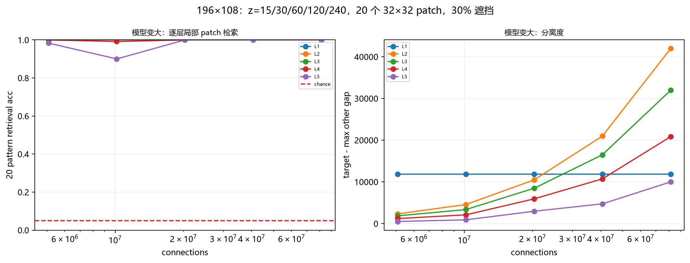
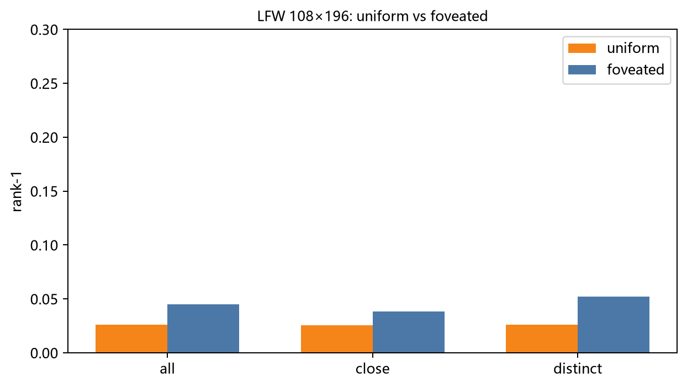
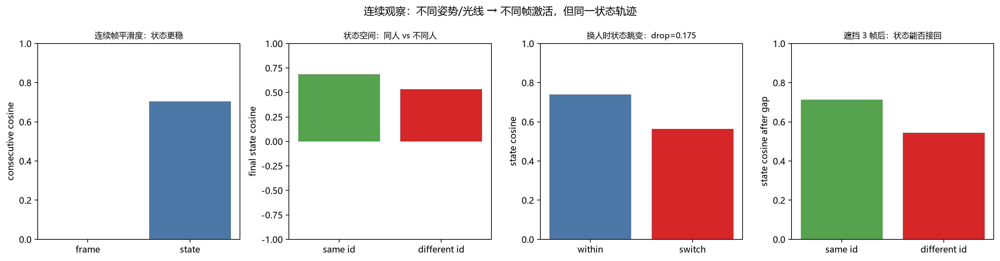
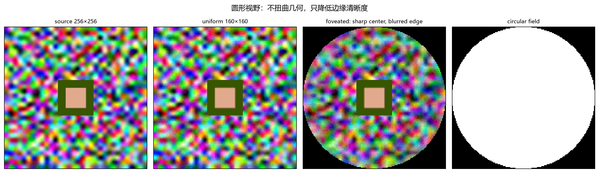
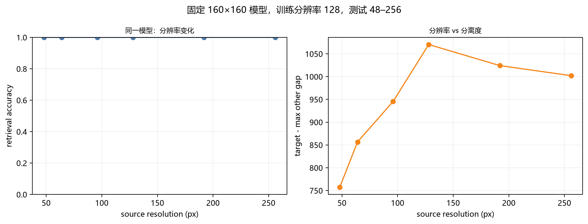
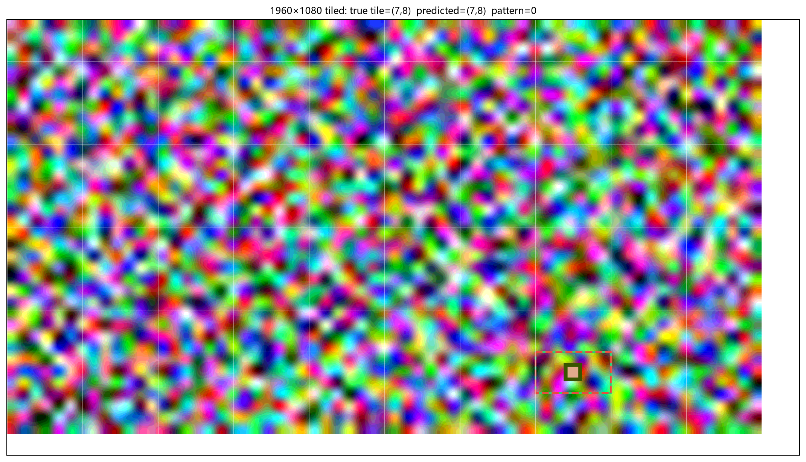

# Local 3D Sparse Networks

固定权重、局部连接的三维稀疏网络。没有卷积、没有训练、没有标签。

研究目标：

1. 相似画面是否激活相似神经元；
2. 局部画面是否比整体画面更容易在前层区分；
3. 模型变大是否提高区分度；
4. 身份是否更像“连续观察的状态轨迹”，而不是固定神经元集合。

> 这是研究原型，不是人脸识别/AGI 产品。  
> 1960×1080 只做了 tiled streaming 局部 patch，不是单体全图网络。

## 核心结构

每个神经元是三维体积 `H×W×Z` 中的一个点：

```
自己 + 3 个随机近邻（dx,dy∈{-1,0,1}, dz∈{-2..2}）
```

每层用全局 top-k 保证精确激活比例；权重固定，不训练。

## 实验索引

| 主题 | 代码 | 文档 | 结论 |
|---|---|---|---|
| 局部 patch 逐层 | `local_patterns_opaque.py` | `LOCAL_PATTERNS.md` | L1–L5 100%，前层 gap 更大 |
| 模型变大 | `scaling_clean.py` | `MODEL_SCALING.md` | gap 随 z 增大，准确率饱和 |
| 连续身份 | `temporal_identity.py` | `TEMPORAL_IDENTITY.md` | 单帧不同，状态轨迹保持身份 |
| 圆形 foveated | `foveated.py` | `FOVEATED.md` | 几何不变，仅中心清晰 |
| 分辨率变化 | `resolution_test.py` | `RESOLUTION.md` | 48–256 都能认出 |
| 1960×1080 tiled | `tiled_1960.py` | `TILED_1960.md` | patch/tile 100% |
| Hebbian attractor | `recurrent_attractor.py` | `RECURRENT_ATTRACTOR.md` | 弱于 EMA，负结果 |
| 人脸中心 foveated | `lfw_face_foveated.py` | `LFW_FACE_FOVEATED.md` | 4.52%，仍很低 |
| LFW 静态身份 | `lfw_rigorous.py` | `LFW_RIGOROUS.md` | 固定身份神经元负结果 |
| 画面相似性 | `lfw_similarity.py` | `LFW_SIMILARITY.md` | ρ=0.989 |

## 主要结果

### 1. 相似画面 → 相似激活

LFW 400 张中心人脸：

- 像素 L1 距离 vs 第5层 Hamming 距离：**Spearman 0.989**；
- L1–L8 都保持：5 层 L5 0.989，8 层 L8 0.990。

### 2. 局部 patch 的逐层区分

20 个完整 48×48 patch × 40 个背景，196×108：

| 层 | 检索准确率 | gap |
|---|---:|---:|
| L1 | 100% | 4,589 |
| L2 | 100% | 3,729 |
| L3 | 100% | 2,766 |
| L4 | 100% | 1,863 |
| L5 | 100% | 947 |

前层 gap 更大：局部性主要在 early layers，整体性在 later layers。

### 3. 模型变大

20 个 32×32 patch × 30% 遮挡，隐藏层宽度 `z=15→240`：

| z | connections | L5 gap | L2 gap |
|---:|---:|---:|---:|
| 15 | 5.08M | 496 | 2,323 |
| 30 | 10.16M | 891 | 4,559 |
| 60 | 20.32M | 2,956 | 10,471 |
| 120 | 40.64M | 4,724 | 20,970 |
| 240 | 81.29M | **9,989** | **41,952** |

- 准确率 z=60 起饱和到 100%；
- gap 持续增大（L5 约 20 倍）；
- 前层 gap 始终大于后层；
- 原始像素基线 100%，null 3.3%–8.3%。



### 4. 静态身份神经元：负结果

LFW 157 人 / 4,286 张：

- Rank-1 7.65%（随机 0.64%）；
- 目标激活率 0.366，最大他人 0.747；
- A/B 固定神经元 Jaccard 0.0049；
- 单神经元 selectivity 与打乱身份的 null 几乎相同。

结论：**没有稳定的固定身份神经元/组合**。

### 5. 大模型 LFW：uniform vs foveated

155 人 / 1,805 张 108×196，L5 30k 神经元，不选固定组合：

| 输入 | Rank-1 全部 | 相似身份 | 不相似身份 |
|---|---:|---:|---:|
| uniform | 2.58% | 2.56% | 2.60% |
| foveated（人脸中心） | **4.52%** | 3.85% | **5.19%** |

foveated 约 1.75 倍于 uniform；方向符合直觉，但绝对水平仍远不能识别人脸。



### 6. 连续观察：身份是状态轨迹

10 个身份 × 3 条序列 × 8 帧；姿势/光线/遮挡/背景变化；196×108：

```
s_t = normalize(0.8 * s_{t-1} + 0.2 * a_t)
```

| 指标 | 数值 |
|---|---:|
| 连续帧激活余弦 | ≈0.00004 |
| 连续状态余弦 | 0.704 |
| 同身份最终状态余弦 | 0.685 |
| 不同身份最终状态余弦 | 0.534 |
| 换人 drop | 0.175 |
| 遮挡 3 帧后同/不同 | 0.714 / 0.545 |
| null 同/不同差 | 0.012 |

不同姿势/光线激活不同帧，但状态轨迹保持身份；不是固定神经元集合。



### 7. 圆形 foveated 输入

整幅圆形视野，中心高分辨率、边缘低分辨率：

| 输入 | 检索准确率 | gap |
|---|---:|---:|
| 均匀 160×160 | 100% | 1,107 |
| 圆形 foveated 160×160 | 100% | 1,080 |

保持几何不变，只降低边缘清晰度；在这个中心目标任务上分离度与均匀输入基本相同。



### 8. 固定模型，改变分辨率

模型固定 160×160；源分辨率 48–256；原型只在 128 训练：

| 源分辨率 | 准确率 | gap |
|---:|---:|---:|
| 48 | 100% | 757 |
| 128（训练） | 100% | **1,070** |
| 256 | 100% | 1,002 |

分辨率降到 48 仍能认出，gap 在训练分辨率附近最高。



### 9. 1960×1080 彩色 tiled

10×10 个 108×196 tile，每个 tile 独立编码，不构建全图单体网络：

- patch 识别 100%；
- 正确 tile 100%；
- 原始像素基线 100%；
- 10 个画布 ×100 tile 全部找对。



### 10. Hebbian recurrent attractor：负结果

512 维投影 + Hebbian 转移矩阵：

| 指标 | EMA | Hebbian attractor |
|---|---:|---:|
| 同身份 - 不同身份 | **0.201** | 0.056 |
| 换人 drop | 0.005 | **0.027** |
| 遮挡后同 - 不同 | **0.311** | 0.062 |

Hebbian 版本能跑，但身份分离和遮挡恢复弱于 EMA；需要更好的 recurrent 结构，而不是只加 W。

## 快速开始

```powershell
$py = "C:\Users\Administrator\AppData\Local\Programs\Python\Python313\python.exe"
pip install -r requirements.txt

# 局部 patch 逐层
& $py -m threednet.local_patterns_opaque

# 模型 scaling
& $py -m threednet.scaling_clean

# 连续观察
& $py -m threednet.temporal_identity

# foveated / 分辨率
& $py -m threednet.foveated
& $py -m threednet.resolution_test

# 1960×1080 tiled / recurrent attractor
& $py -m threednet.tiled_1960
& $py -m threednet.recurrent_attractor
```

## LFW 复现

LFW 不包含在仓库中。下载并解压到：

```
data/lfw/lfw/<person_name>/<image.jpg>
```

然后：

```powershell
& $py -m threednet.prepare_lfw
& $py -m threednet.lfw_rigorous
& $py -m threednet.prepare_lfw_large
& $py -m threednet.lfw_face_foveated
```

LFW 仅用于研究，遵守原数据集许可；不得用于监控/部署。

## 测试

```powershell
& $py tests/test_threednet.py
& $py tests/test_scaling.py
& $py tests/test_temporal_identity.py
& $py tests/test_foveated.py
& $py tests/test_resolution.py
& $py tests/test_tiled.py
& $py tests/test_lfw_face_foveated.py
```

仓库内包含 8 个关键测试；本地完整测试集 30 个通过（其余测试依赖旧分支，未全部打包）。

## 限制

- 1960×1080 只做了 tiled streaming，没有单体全图网络；
- 单体 1960×1080 约 22.5GB 连接，8GB GPU 放不下；
- Hebbian recurrent attractor 已实现，但身份分离弱于 EMA；
- 只有合成 patch/背景，没有真实视频；
- 没有多 seed/置信区间；
- 没有平移/尺度不变性要求，也不应强加；
- foveated 与 1960×1080 还没有结合；
- 不证明“足够大就能识别人脸”。

## 文件

```
threednet/          网络与实验
tests/              单元测试
results/            JSON + 图
LOCAL_PATTERNS.md   局部 patch 逐层实验
MODEL_SCALING.md    模型变大实验
TEMPORAL_IDENTITY.md 连续观察身份
LFW_FACE_FOVEATED.md LFW 人脸中心 foveated
FOVEATED.md         圆形中央高分辨率输入
RESOLUTION.md       固定模型、改变分辨率
TILED_1960.md       1960×1080 tiled streaming
RECURRENT_ATTRACTOR.md Hebbian recurrent attractor
LFW_RIGOROUS.md     LFW 静态身份负结果
LFW_SIMILARITY.md   LFW 画面相似性
```

## License

代码 MIT。数据（LFW/Olivetti）遵循各自许可，不随仓库分发。


