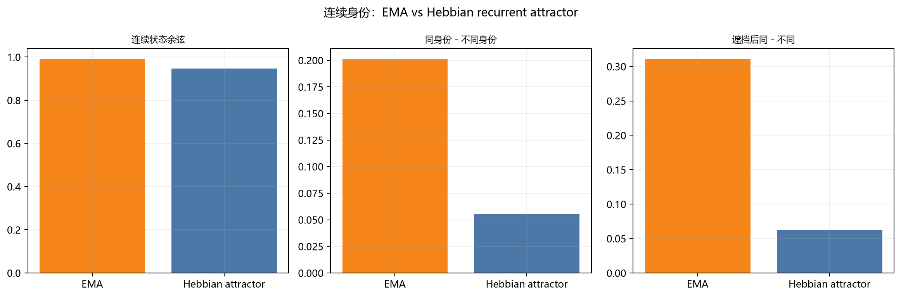

# Hebbian recurrent attractor vs EMA

## 1. 做法

- 每帧 L5 中央区激活 → 固定稀疏投影到 512 维 `x_t`；
- 用前两条序列的相邻帧，按 Hebbian 外积学习转移矩阵：

```
W = Σ x_t x_{t-1}^T
```

- 不训练标签，只学帧间转移；
- 状态更新：

```
s_t = normalize((1-β) s_{t-1} + β tanh(W s_{t-1} + x_t))
```

- β=0.6；
- 第三条序列作为测试；
- 与 EMA `s_t = normalize(0.8 s_{t-1} + 0.2 x_t)` 对比。

## 2. 结果

| 指标 | EMA | Hebbian attractor |
|---|---:|---:|
| 连续状态余弦 | 0.991 | 0.946 |
| 同身份 - 不同身份 | **0.201** | 0.056 |
| 换人 drop | 0.005 | **0.027** |
| 遮挡后同 - 不同 | **0.311** | 0.062 |



## 3. 说明什么

- Hebbian attractor 能跑通，状态更动态，换人 drop 比 EMA 大；
- 但它的身份分离和遮挡恢复明显弱于 EMA；
- 对称化 + 谱归一化后的转移矩阵把不同身份拉向共同吸引子；
- 当前 Hebbian 版本还不是更好的身份模型。

这是一个诚实的负结果：

> **Hebbian 转移矩阵本身没有自动产生更强的身份分离；  
> 需要更好的 recurrent 结构/归一化/稀疏约束，而不是只加一个 W。**

## 4. 限制

- W 是对称化后的 512×512 矩阵；
- 只有 10 个身份、3 条序列、8 帧；
- 没有网格搜索 β、投影维度、W 归一化；
- 没有用标签调整 W。

## 5. 文件

```
threednet/recurrent_attractor.py
results/recurrent_attractor.json
results/fig_recurrent_attractor.png
RECURRENT_ATTRACTOR.md
```
